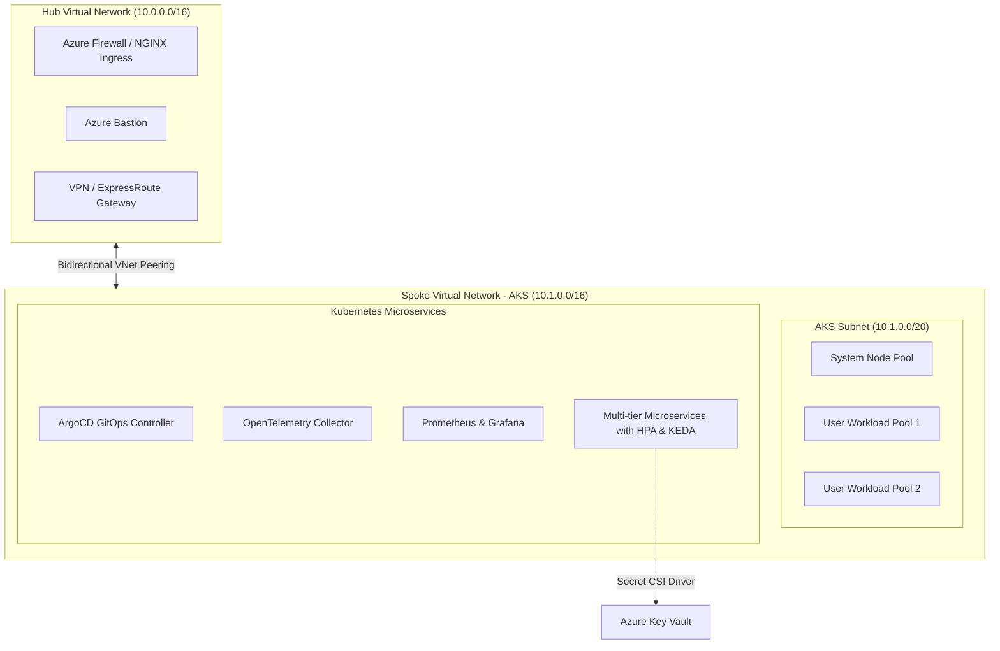

# ☸️ Enterprise Azure Kubernetes Service (AKS) & GitOps Reference Architecture

[](https://azure.microsoft.com/services/kubernetes-service/)
[](https://www.terraform.io/)
[](https://argoproj.github.io/cd/)
[](https://kubernetes.io/)
[](https://grafana.com/)
[](https://www.infracost.io/)

Production-grade, enterprise reference architecture implementing **Azure Kubernetes Service (AKS)** on a **Hub-and-Spoke Virtual Network**, automated declarative delivery with **ArgoCD GitOps**, **Helm 3**, autoscaling via **HPA & KEDA**, end-to-end **Observability (Prometheus, Grafana, OpenTelemetry, Loki)**, and **FinOps Cost Governance with Infracost**.

---

## 🏛️ Enterprise Hub-and-Spoke Architecture



---

## ⚡ Core Technical Capabilities

- **Secure Network Isolation**: Terraform-provisioned Hub-and-Spoke topology with Azure Firewall, private endpoints, and strict Network Security Groups (NSGs).
- **GitOps Continuous Delivery**: ArgoCD App-of-Apps pattern managing multi-environment releases (`Dev`, `SIT`, `UAT`, `Production`) with zero configuration drift and automated self-healing.
- **Dynamic Autoscaling**: Horizontal Pod Autoscaler (HPA) paired with **KEDA** (Kubernetes Event-driven Autoscaling) to handle peak traffic spikes seamlessly while preventing resource wastage.
- **Full Observability & SLI/SLO Monitoring**: Preconfigured Prometheus alert rules monitoring the **4 Golden Signals** (Latency, Traffic, Errors, Saturation) and tracking error budget burn rates to reduce **MTTR**.
- **FinOps Governance**: Infracost CI/CD integration auditing pull-request cloud expenditure shifts before deployment.

---

## 📂 Repository Layout

```
azure-aks-enterprise-gitops/
├── terraform/
│   ├── hub-spoke/              # Hub-and-Spoke VNet, Peering, Subnets, and Firewalls
│   └── aks-cluster/            # Production AKS cluster, node pools, Key Vault CSI
├── gitops/
│   ├── argocd/                 # Root App-of-Apps declarative manifests
│   └── environments/           # Multi-environment definitions (Dev, SIT, Prod)
├── helm/
│   └── microservice-app/       # Production Helm chart with HPA, KEDA, and Rolling Updates
├── observability/
│   ├── prometheus/             # PrometheusRules for Golden Signals and SLO burn rate
│   └── opentelemetry/          # OpenTelemetry collector configuration
├── finops/
│   └── infracost.yml           # Multi-project Infracost cost governance config
└── .github/
    └── workflows/
        └── infra-gitops-pipeline.yml # Automated linting, tfsec, and Infracost CI
```

---

## 🚀 Deployment Guide

### 1. Provision Hub-and-Spoke Infrastructure
```bash
cd terraform/hub-spoke
terraform init
terraform plan -out=hub.tfplan
terraform apply hub.tfplan
```

### 2. Deploy Azure Kubernetes Service
```bash
cd ../aks-cluster
terraform init
terraform plan -out=aks.tfplan
terraform apply aks.tfplan
```

### 3. Initialize ArgoCD GitOps Controller
```bash
# Connect to AKS cluster
az aks get-credentials --resource-group rg-enterprise-spoke-aks-prod --name aks-enterprise-prod

# Apply ArgoCD Root Application
kubectl apply -f gitops/argocd/root-app-of-apps.yaml
```

---

## 📊 SRE & Reliability Architecture
- **Zero-Downtime Releases**: Configured with `maxSurge: 25%` and `maxUnavailable: 0` ensuring zero packet loss during application rollouts.
- **Incident Response & MTTR**: Automated alerting notifies on-call teams when error budgets exceed 14.4x normal consumption, triggering automated remediation.

---
**Maintained by [Mithilesh Yadav](https://github.com/Mit-Yadav)** | Enterprise DevOps & SRE Engineer | Cloud & Agentic AI Architect
